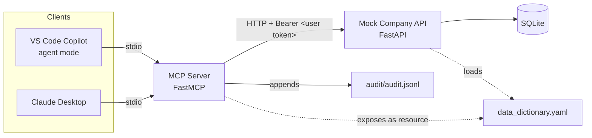
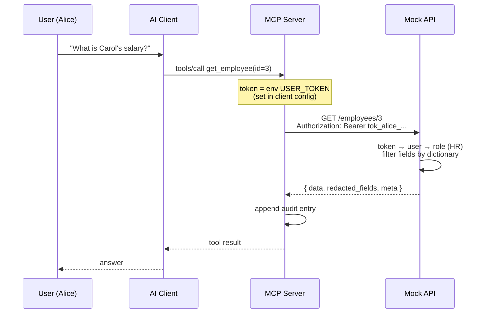

# Design: Permission-Aware MCP Server for Company Data

**Status:** Draft v2 (adds Manager role and row-level filtering) · **Author:** _your name_ · **Last updated:** 2026-10-27

---

## 1. Goal

Build a small MCP server that lets AI clients (VS Code Copilot agent mode and Claude Desktop) query a mock company employee directory, where **what the AI can see is exactly what the signed-in user is allowed to see**.

The MCP server never holds its own privileged credentials. It forwards the user's token to the downstream system, and the downstream system decides what to return.

> The same question must produce different answers depending on who asks:
> - **Alice (HR)** sees every employee, including salary.
> - **Bob (Engineer)** sees every employee, but no salary or other HR fields.
> - **Dave (Manager, Engineering)** sees only his own department, including performance ratings but not salary.

## 2. Non-goals

- Real identity provider or OAuth flow. Static mock tokens stand in for it (see §10).
- Production hardening: rate limiting, TLS, secrets management.
- Write operations. All tools are read-only.
- Any UI beyond the AI clients themselves.

## 3. Architecture



| Component | Responsibility | Must NOT |
|---|---|---|
| **MCP server** | Expose tools/resources, forward the user token, log every call | Hold its own credentials, filter or check permissions, cache data across users |
| **Mock API** | Authenticate the token, resolve role, filter rows and fields | Trust anything from the caller except the token |
| **Data dictionary** | Single source of truth for fields, owners, sensitivity, allowed roles | Be duplicated or hard-coded elsewhere |
| **Audit log** | Record who asked what, and what was returned or denied | Contain token values or field *values* |

## 4. Token flow



1. Each user has a separate server entry in their client config (e.g. `employees-alice`, `employees-bob`), each launched with its own `USER_TOKEN` environment variable.
2. The MCP server reads `USER_TOKEN` at startup. If it is missing, the server fails to start with a clear error. **There is no fallback token.**
3. Every API request carries `Authorization: Bearer <USER_TOKEN>`.
4. The API resolves the token to a user and role. It returns `401` for an unknown token, and `403` when the role has no access to the resource at all.

## 5. Permission model

### Users and roles (seed data)

| User | Role | Department | Token (mock) |
|---|---|---|---|
| Alice | `HR` | HR | `tok_alice_hr` |
| Bob | `Engineer` | Engineering | `tok_bob_eng` |
| Dave | `Manager` | Engineering | `tok_dave_mgr` |

Tokens are fake values for local demo only. Real tokens would come from an identity provider (§10). Each user row links to an employee record, which is how the API finds the caller's department.

### Role policies

Row scope is stored per role in the `roles` table in SQLite. Field access comes from the data dictionary (§6). These are two separate concerns kept in two places: the dictionary describes *data*, and the roles table describes *who can see which records*.

| Role | Row scope | Fields (from dictionary) |
|---|---|---|
| `HR` | `all` | All dictionary fields |
| `Engineer` | `all` | Public and internal fields, except `start_date` |
| `Manager` | `own_department` | Public and internal fields, plus `start_date` and `performance_rating`. No `salary` |

### Rules

- **Field-level:** a field is returned only if the caller's role is in that field's `allowed_roles` in the data dictionary.
- **Default deny:** a field present in the database but missing from the dictionary is never returned, to any role.
- **Row-level:** the API applies the role's row scope before anything else.
  - `all`: no row filter.
  - `own_department`: only employees whose `department` matches the caller's department.
  - Row filtering runs in the SQL query itself, not afterwards in Python, so out-of-scope rows are never loaded.
- **Out-of-scope rows:**
  - `get_employee` for an out-of-scope id returns `403 {"error":"out_of_scope"}`. This reveals that the record exists, which is acceptable here because the directory itself is not secret: Engineers can see every row.
  - `search` silently leaves out-of-scope rows out of its results, and reports how many were excluded (§7).
- **Search safety:** `search` matches only against fields the caller is allowed to see. Bob cannot run a query like "salary > 150000" to infer hidden values.
- **Enforcement location:** only the API enforces. The MCP server passes results through unchanged.

## 6. Data dictionary

**File:** `data_dictionary.yaml` (repo root). The API loads it at startup to enforce access. The MCP server exposes it read-only as a resource.

### Schema

```yaml
version: 1
entity: employee
fields:
  - name: salary                # column name in the database
    description: Annual base salary in USD
    type: integer
    owner: HR                   # team accountable for definition & quality
    sensitivity: confidential   # public | internal | confidential
    allowed_roles: [HR]
```

### Initial fields

| Field | Sensitivity | Allowed roles | Owner |
|---|---|---|---|
| `id` | public | HR, Engineer, Manager | HR |
| `name` | public | HR, Engineer, Manager | HR |
| `email` | internal | HR, Engineer, Manager | IT |
| `department` | internal | HR, Engineer, Manager | HR |
| `title` | internal | HR, Engineer, Manager | HR |
| `manager_id` | internal | HR, Engineer, Manager | HR |
| `location` | internal | HR, Engineer, Manager | Facilities |
| `start_date` | internal | HR, Manager | HR |
| `salary` | confidential | HR | HR |
| `performance_rating` | confidential | HR, Manager | HR |

The database also contains a `home_address` column that is deliberately left **out of** the dictionary, to demonstrate default deny.

## 7. Mock API contract

Base URL: `http://localhost:8000`

| Method | Path | Purpose |
|---|---|---|
| GET | `/employees?q=<text>` | Search by name, department, or title (only fields the caller can see) |
| GET | `/employees/{id}` | Single employee |
| GET | `/health` | Liveness check. No auth required |

**Response envelope (all authenticated endpoints):**

```json
{
  "data": [ { "id": 3, "name": "Carol Diaz", "department": "Engineering" } ],
  "redacted_fields": ["salary", "performance_rating", "start_date"],
  "meta": { "user": "bob", "role": "Engineer", "row_scope": "all", "rows_excluded": 0 }
}
```

- `redacted_fields` lists fields that exist on the entity but were withheld from this caller. It does **not** include fields missing from the dictionary (`home_address` stays invisible).
- `meta` lets the MCP server log the caller's identity without decoding the token itself.
  - `row_scope` is either `all` or the scope applied, for example `department=Engineering`.
  - `rows_excluded` counts the matches hidden by row scope. It is a count only, so no names or ids leak. The assistant can say "3 more matches are outside your access" instead of claiming they don't exist.

**Errors:** `401 {"error":"invalid_token"}`, `403 {"error":"forbidden"}`, `403 {"error":"out_of_scope"}`, `404 {"error":"not_found"}`.

## 8. MCP server

Built in Python with the official MCP SDK (`FastMCP`), using stdio transport.

### Tools

| Tool | Input | Output | Calls API? |
|---|---|---|---|
| `search_employees` | `query: str` | List of employees (visible fields), plus `redacted_fields` | Yes, `GET /employees?q=` |
| `get_employee` | `id: int` | One employee, plus `redacted_fields` | Yes, `GET /employees/{id}` |
| `describe_field` | `field_name: str` | Dictionary entry (description, owner, sensitivity, allowed roles) | No, reads the YAML |

Tool descriptions should tell the model that withheld fields are listed in `redacted_fields`, and that it should say a field is restricted rather than guess its value.

### Resource

- `datadict://employee`: the full data dictionary as YAML. Field metadata is not sensitive; field *values* are.

### Error handling

API errors map to clear tool errors the model can relay. For example, a 401 becomes "Your access token is invalid or expired", an `out_of_scope` 403 becomes "That employee is outside your access scope", and a 404 becomes "No employee with id 42". The server never retries with different credentials.

## 9. Audit log

**File:** `audit/audit.jsonl`, written by the MCP server with one line per tool call.

```json
{"ts":"2026-10-26T14:02:11Z","user":"bob","role":"Engineer","tool":"get_employee",
 "args":{"id":3},"status":"ok","fields_returned":["id","name","email","department"],
 "fields_denied":["salary","performance_rating","start_date"],
 "row_scope":"all","rows_excluded":0}
```

- **Never** log token values or field values. Log field names only.
- Failed calls are logged too: `status` is `"401"`, `"out_of_scope"`, `"404"`, or `"error"`.
- `audit/summarize_denied.py` reads the log and prints:
  - the top denied fields, by count
  - for each denied field, the users who requested it
  - out-of-scope requests per user, plus the total rows excluded from searches

  The purpose is to show the feedback loop: frequent legitimate denials suggest a dictionary or role change.

## 10. Security notes and production mapping

| Demo | Production equivalent |
|---|---|
| Static token in an env var per client config | OAuth sign-in in the MCP client; the MCP server receives the user's access token |
| Single mock API | Downstream systems (Graph, HRIS, SharePoint, …) each enforcing their own permissions |
| Token passed straight through | On-behalf-of (OBO) token exchange per downstream API, keeping the user's identity |
| Roles in SQLite | Groups or app roles from the identity provider |
| Department-scoped rows | Org-hierarchy or attribute-based policies in the source system (e.g. reporting chain) |

The core invariant carries over unchanged: **the MCP layer never has more access than the user.**

## 11. Acceptance criteria

1. As Bob, "What is Carol's salary?" returns no salary, and the assistant says it is restricted.
2. As Alice, the same question returns the salary.
3. As Dave, the same question about Carol (Engineering) returns her performance rating but no salary.
4. As Dave, asking about Frank (Sales) returns an out-of-scope message. A search for "Sales" returns no rows, plus a note that matches were outside his scope.
5. As Bob and as Alice, the same Sales search returns Frank.
6. `home_address` is never returned to anyone.
7. Starting the MCP server without `USER_TOKEN` fails with a clear error.
8. An invalid token produces a 401 tool error, and the server makes no fallback attempt.
9. Every tool call appears in `audit.jsonl`. The summary script lists `salary` as a top denied field, and shows Dave's out-of-scope requests.
10. A grep of the MCP server code finds no hard-coded tokens and no permission logic.
11. The demo works in both VS Code Copilot and Claude Desktop.

## 12. Open questions

- Should `describe_field` hide fields the caller can't access? Proposal: no. Metadata is public, values are not.

## 13. Decisions log

- **2026-10-27:** Added the Manager role with `own_department` row scope to demonstrate row-level filtering alongside field-level filtering. Row scope lives in the `roles` table, not the data dictionary.
